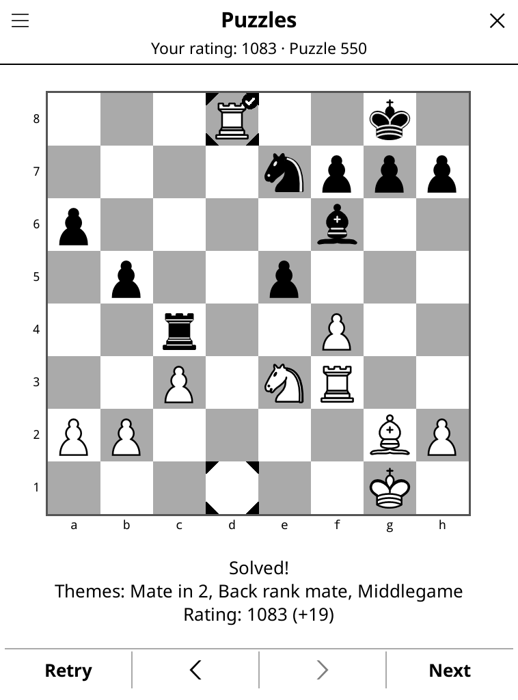
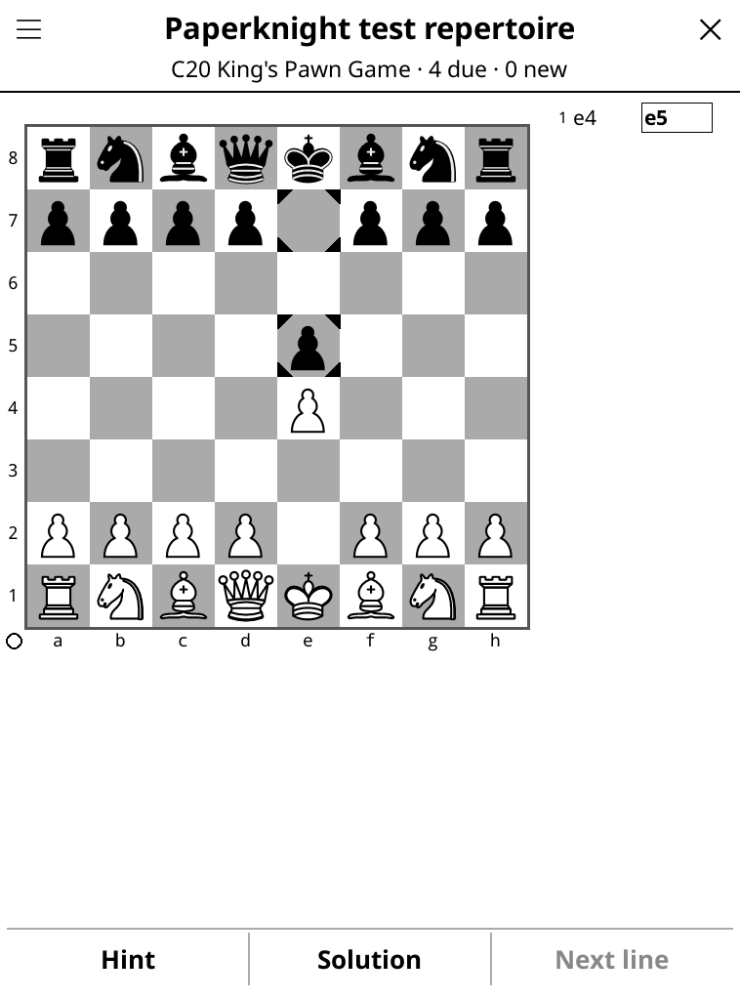
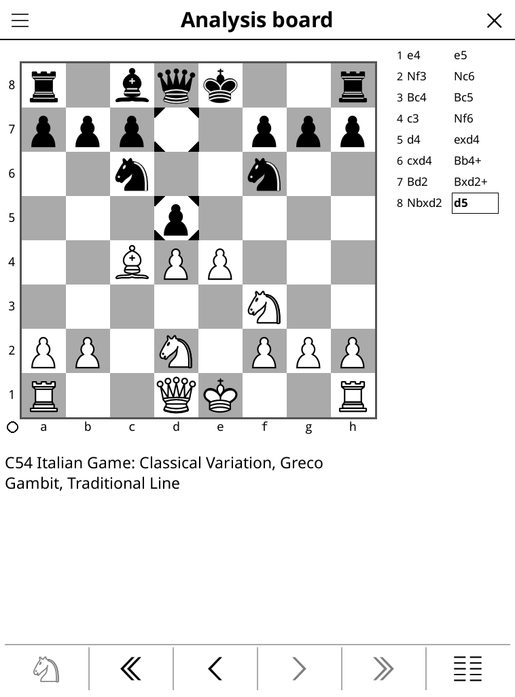
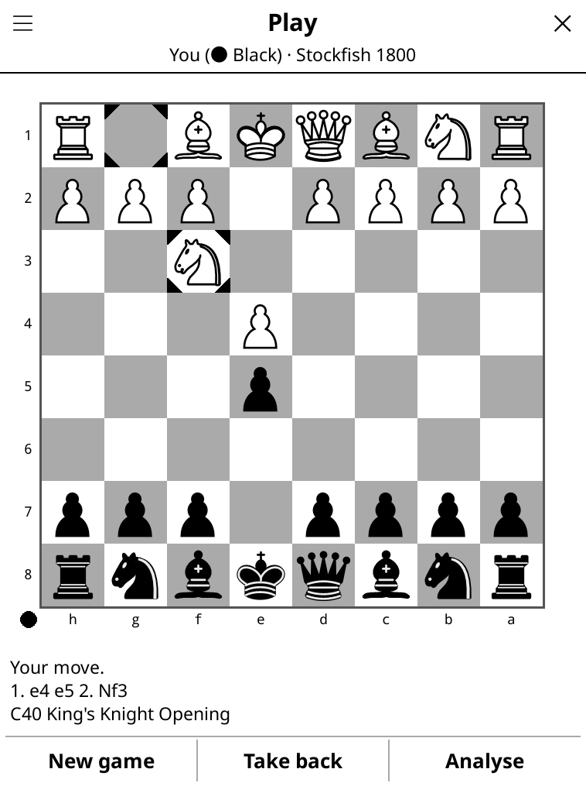
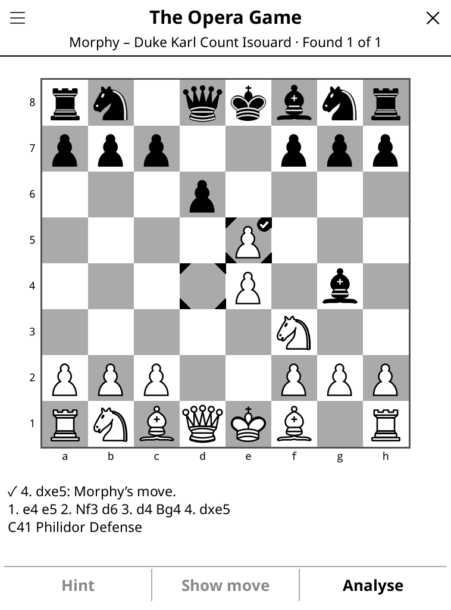
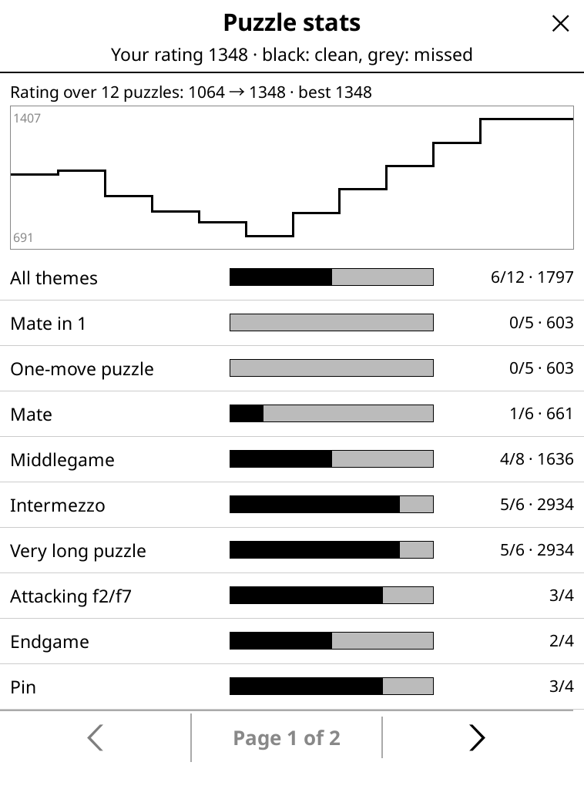

# Paperknight

**Offline chess training for e-ink readers.** Paperknight is a
[KOReader](https://koreader.rocks) plugin that turns an e-reader into
a chess trainer: rated tactics puzzles, Lichess studies, your own opening
repertoire with spaced repetition, an analysis board and Stockfish, all on
the e-ink screen and without a network connection.

It is designed for the **Kindle Paperwhite 2** and its 6" e-ink screen: the
board is drawn and refreshed so that moves don't flash. It should run on any
e-reader with KOReader (other Kindles, Kobo, PocketBook), but has only been
tested on the Paperwhite 2: if you try it on another one,
[say how it went](https://github.com/corentingi/paperknight/issues/new/choose).

| Puzzles | Studies | Openings |
|---|---|---|
|  |  |  |
| **Analysis board** | **Play** | **Master games** |
|  |  |  |
| **Puzzle stats** | **Night mode** | |
|  |  | |

## Features

- **Puzzles** from the Lichess puzzle database, fully offline: a Glicko-2
  rating, puzzles picked around your level, a theme filter (forks, mates in
  2…), hints and solutions, and missed puzzles that come back after 3, 7
  and 21 days. A stats page shows your results per theme, weakest first.
  Like a puzzle to come back to it later, or open any puzzle of the pack by
  its Lichess id.
- **Studies**: any PGN or Lichess study, with chapters, variations,
  comments, arrows and circles, interactive lessons, and a move list you can
  tap to jump to a move.
- **Openings**: drill your own repertoire (a PGN or a Lichess study) with
  spaced repetition. New moves are shown first, then tested on the days
  after; moves you know are played for you, and the trainer stops on what is
  due.
- **Analysis board**: play both sides, step through the line, set a position
  from a FEN, save the line as a study, open the position on Lichess with a
  phone (QR code), and see Stockfish's evaluation and best line.
- **Play** against Stockfish (your side, its strength from 1350 Elo to full
  strength, an optional clock), or two players face to face on one Kindle
  (Black's pieces upside down). A game in progress comes back when you open
  Play again; take back, resign, save it as a study, or analyse it.
- **Master games**: guess the moves of 75 famous games, from the Immortal
  Game (1851) to Ding – Gukesh (2024), women's world champions included. Moves as good as the master's count too
  (judged by Stockfish beforehand: no engine needed), key moments are
  announced, and your best score per game is kept.
- **Opening names** ("C50 Italian Game") everywhere a line is played.
- **Made for e-ink**: no flashing moves, a night mode, and links in
  comments shown as QR codes to open on a phone.

Everything runs on the device: no account, no tracking, no network needed
once installed. In English and French (KOReader's language);
[other languages](docs/translations.md) are welcome. A problem, or news of
how it runs on your e-reader: *Settings… → Report a problem…*, or
[an issue](https://github.com/corentingi/paperknight/issues/new/choose).

## Install

You need an e-reader with [KOReader](https://koreader.rocks) installed (a
jailbroken Kindle, a Kobo, a PocketBook…; tested on a Kindle Paperwhite 2
with KOReader 2026.07). KOReader's folder is `koreader` at the root of a
Kindle, `.adds/koreader` on a Kobo, `applications/koreader` on a PocketBook.

**Over USB** (no terminal needed):

1. Download `paperknight-<version>-usb.zip` from the
   [latest release](https://github.com/corentingi/paperknight/releases/latest).
2. Unzip it, connect the e-reader over USB, and copy **what is inside** the
   zip's `koreader` folder (`plugins`, `fonts`, `paperknight`) into the
   device's KOReader folder. Don't replace that folder itself (on a Mac,
   Finder would delete KOReader's own files).
3. Restart KOReader: **Paperknight** is in the **Tools** menu (KOReader's
   gesture settings can also open it with one tap, *Paperknight* action).

The zip holds everything: the plugin, the puzzle pack, an emoji font and
**Stockfish**, the engine behind the analysis board and *Play* against the
engine (Stockfish 18 built for the Paperwhite 2's ARMv7 processor, about
3 MB, [details](docs/stockfish.md); it should run on most ARMv7 e-readers,
and the installer checks that it starts).

**In a terminal** on the e-reader (kterm or SSH; the installer finds
KOReader on a Kindle, a Kobo or a PocketBook):

    curl -fkL https://github.com/corentingi/paperknight/releases/latest/download/install.sh | sh

The installer shows what it will install and offers Stockfish. It checks
every download before changing anything, and your own studies and
repertoires are kept.

**To update**, either way: **Settings… → Check for updates…** in Paperknight
(Wi-Fi on). It lists what changed, downloads only that, and offers to
restart KOReader. It runs the same installer, which you can also run again
from a terminal.

**Checked downloads**: the in-app update checks GitHub's certificate with
KOReader's own certificate list, and the installer then checks every
archive against the checksum it holds. A device whose `curl` is too old to
check the certificate downloads the installer without that check, and the
update says so ([ADR-0019](docs/adr/0019-in-app-update-runs-the-installer.md)).
The terminal command above uses `curl -k` (no certificate check) so that it
works everywhere; where the device's `curl` can check it, use KOReader's
list instead, e.g. on a Kindle:

    curl -fL --cacert /mnt/us/koreader/data/ca-bundle.crt https://github.com/corentingi/paperknight/releases/latest/download/install.sh | sh

Or install over USB with a zip downloaded on your computer.

**Your progress** (rating, puzzles to review, repertoires, games in
progress) is copied once a day; *Settings… → Restore progress from its
copy…* puts the copy back, and Paperknight offers it if the file is ever
damaged.

**Your own studies and repertoires**: copy PGN files (for example a Lichess
study exported as PGN) to `koreader/paperknight/studies/` or
`koreader/paperknight/repertoires/` on the Kindle. See
[studies](docs/studies.md) and [openings](docs/openings.md).

## Using it

- The **home screen** lists the modes: Puzzles, Studies, Openings, Analysis
  board, Play, Master games.
- A tap on a screen's **title** opens the quick menu: frontlight, night
  mode, switching mode, home.
- **☰** (top left) has the actions of the screen you are on: themes and
  stats for puzzles, chapters and *Flip board* for studies, *Save line as a
  study* for the analysis board…
- The disc in the board's bottom-left corner shows whose move it is
  (○ White, ● Black).

## Development

The plugin is Lua (KOReader's LuaJIT); the data packs are built by a Python
pipeline; a headless desktop KOReader runs end-to-end tests.

```sh
make help          # list targets
make check         # linters, unit tests (plugin + pipeline), installer tests, headless end-to-end scenarios
make emulator      # the plugin in a desktop KOReader window
make packs         # download the Lichess puzzle database (~300 MB, once) and build the puzzle pack
make dist          # device files in build/dist/out: install.sh, one archive per part, a USB zip
```

`make dist` needs `PAPERKNIGHT_DIST_URL`, the address the files will be
served from (set it in the environment or in a `local.mk` file).

Contributions are welcome: see [CONTRIBUTING.md](CONTRIBUTING.md).

| Path | What lives there |
|---|---|
| [`plugin/paperknight.koplugin/`](plugin/) | The KOReader plugin (Lua) |
| [`pipeline/`](pipeline/) | Python tools that download public datasets and build the data packs |
| [`tools/emulator/`](tools/emulator/) | The desktop KOReader that runs the end-to-end tests |
| [`tools/dist/`](tools/dist/) | The installer, the release files and the Stockfish build |
| [`docs/`](docs/) | [Architecture](docs/architecture.md), [development guide](docs/development.md), [releasing](docs/releasing.md), [e-ink refreshes](docs/eink-refresh.md), [decision records](docs/adr/), [roadmap](docs/roadmap.md) |
| [`site/`](site/) | The project's web page (GitHub Pages) |

## Credits and license

Paperknight started as a fork of [Kochess](https://github.com/bateast/kochess)
and uses [chess.lua](https://github.com/arizati/chess.lua). Puzzles and
opening names come from [Lichess](https://lichess.org)'s open databases
(CC0); the engine is [Stockfish](https://stockfishchess.org) (GPLv3). See
[`docs/credits.md`](docs/credits.md).

GPL-3.0-or-later, see [`LICENSE`](LICENSE).
