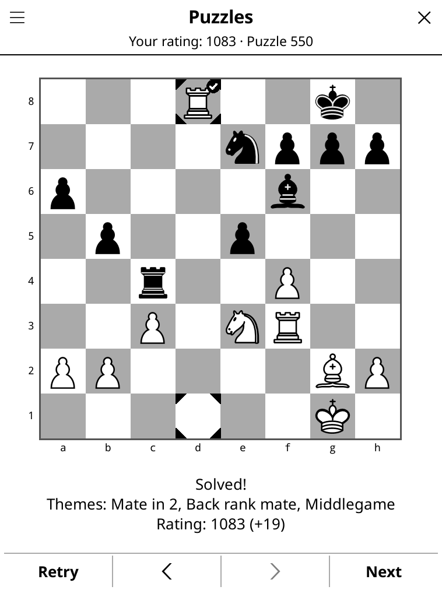
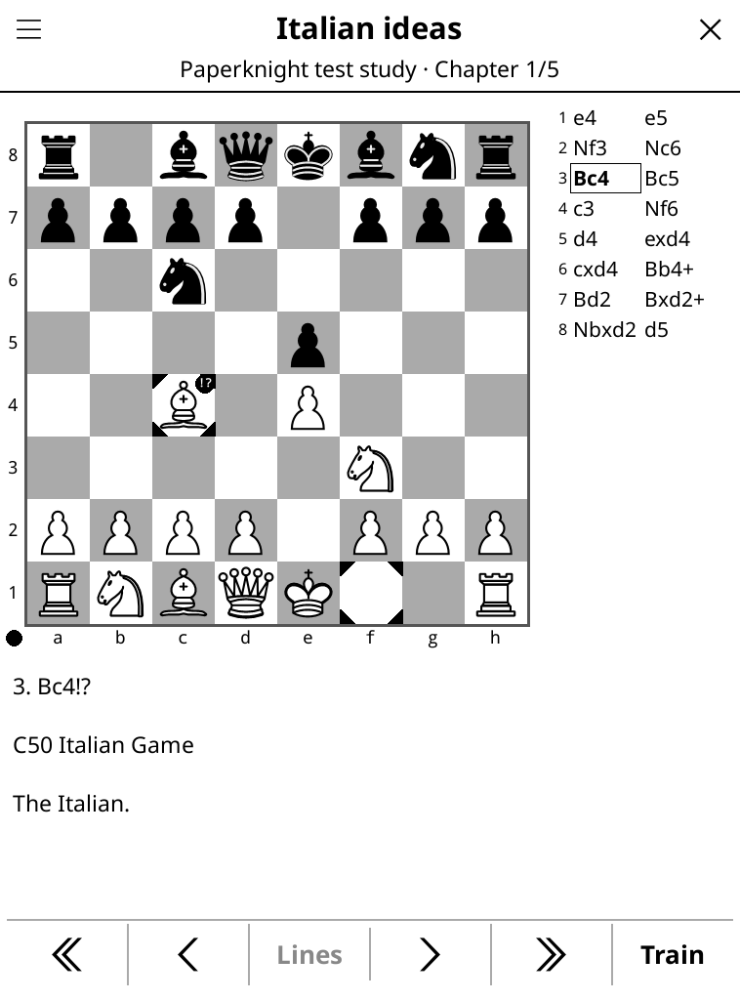
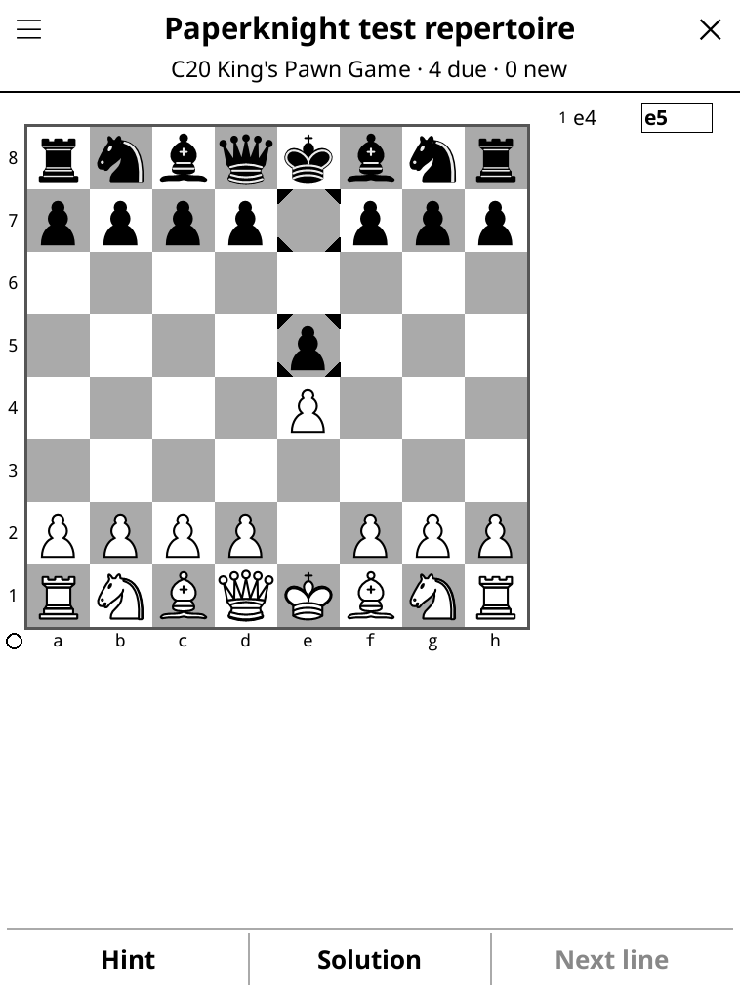
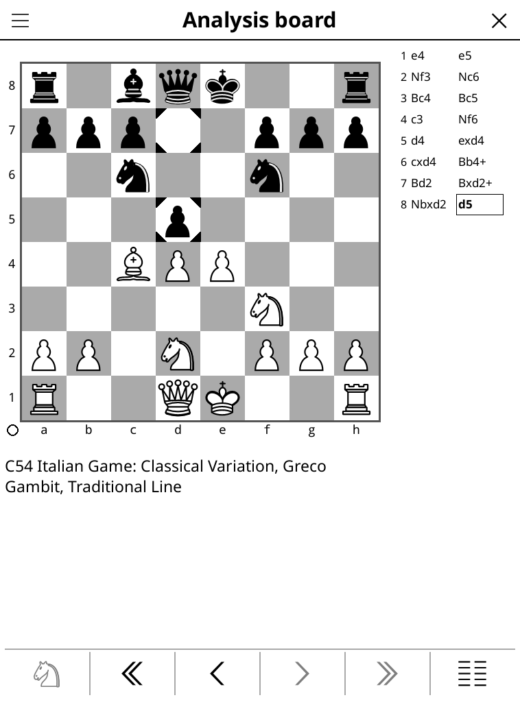
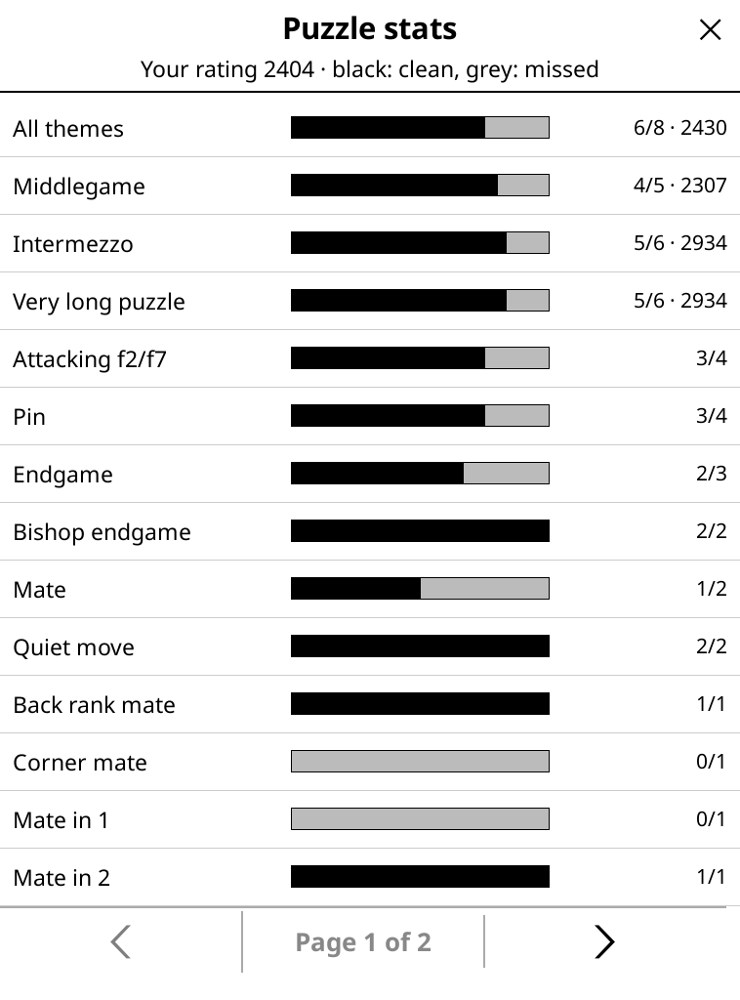

# Paperknight

**Offline chess training for e-ink readers.** Paperknight is a
[KOReader](https://koreader.rocks) plugin that turns a jailbroken Kindle into
a chess trainer: rated tactics puzzles, Lichess studies, your own opening
repertoire with spaced repetition, an analysis board and Stockfish, all on
the e-ink screen and without a network connection.

It is designed for the **Kindle Paperwhite 2** and its 6" e-ink screen: the
board is drawn and refreshed so that moves don't flash.

| Puzzles | Studies | Openings |
|---|---|---|
|  |  |  |
| **Analysis board** | **Puzzle stats** | **Night mode** |
|  |  |  |

## Features

- **Puzzles** from the Lichess puzzle database, fully offline: a Glicko-2
  rating, puzzles picked around your level, a theme filter (forks, mates in
  2…), hints and solutions, and missed puzzles that come back after 3, 7
  and 21 days. A stats page shows your results per theme, weakest first.
- **Studies**: any PGN or Lichess study, with chapters, variations,
  comments, arrows and circles, interactive lessons, and a move list you can
  tap to jump to a move.
- **Openings**: drill your own repertoire (a PGN or a Lichess study) with
  spaced repetition. New moves are shown first, then tested on the days
  after; moves you know are played for you, and the trainer stops on what is
  due.
- **Analysis board**: play both sides, step through the line, set a position
  from a FEN, save the line as a study, and see Stockfish's evaluation and
  best line.
- **Play** against Stockfish, or two players on one board.
- **Opening names** ("C50 Italian Game") everywhere a line is played.
- **Made for e-ink**: no flashing moves, a night mode, and links in
  comments shown as QR codes to open on a phone.

Everything runs on the device: no account, no tracking, no network needed
once installed.

## Install

You need a jailbroken Kindle with [KOReader](https://koreader.rocks)
installed (tested on a Kindle Paperwhite 2 with KOReader 2026.07).

In a terminal on the Kindle (kterm or SSH):

    curl -fkL https://github.com/corentingi/paperknight/releases/latest/download/install.sh | sh

The installer shows what it will install (the plugin, the puzzle pack, an
emoji font) and offers **Stockfish**, the engine behind the analysis board
and *Play against the engine* (Stockfish 18 built for the Paperwhite 2,
about 3 MB, [details](docs/stockfish.md)). It checks every download before
changing anything. Run it again to update: it downloads only what changed,
and your own studies and repertoires are kept. Then restart KOReader:
**Paperknight** is in the **Tools** menu (KOReader's gesture settings can
also open it with one tap, *Paperknight* action).

Without a terminal: download `paperknight-<version>-usb.zip` from the
[latest release](https://github.com/corentingi/paperknight/releases/latest),
unzip it and copy its `koreader` folder onto the Kindle over USB.

> The first release is not published yet. Until then, build the files
> yourself (`make dist`, see [Development](#development)) and serve them.

**Your own studies and repertoires**: copy PGN files (for example a Lichess
study exported as PGN) to `koreader/paperknight/studies/` or
`koreader/paperknight/repertoires/` on the Kindle. See
[studies](docs/studies.md) and [openings](docs/openings.md).

## Using it

- The **home screen** lists the modes: Puzzles, Studies, Openings, Analysis
  board, Play.
- A tap on a screen's **title** opens the quick menu: frontlight, night
  mode, switching mode, home.
- **☰** (top left) has the actions of the screen you are on: themes and
  stats for puzzles, chapters and *Flip board* for studies, *Save line as a
  study* for the analysis board…
- The disc in the board's bottom-left corner shows whose move it is
  (○ White, ● Black).

## Development

The plugin is Lua (KOReader's LuaJIT); the data packs are built by a Python
pipeline; a headless desktop KOReader runs end-to-end tests.

```sh
make help          # list targets
make check         # unit tests (plugin + pipeline) and headless end-to-end scenarios
make emulator      # the plugin in a desktop KOReader window
make packs         # download the Lichess puzzle database (~300 MB, once) and build the puzzle pack
make dist          # device files in build/dist/out: install.sh, one archive per part, a USB zip
```

`make dist` needs `PAPERKNIGHT_DIST_URL`, the address the files will be
served from (set it in the environment or in a `local.mk` file).

| Path | What lives there |
|---|---|
| [`plugin/paperknight.koplugin/`](plugin/) | The KOReader plugin (Lua) |
| [`pipeline/`](pipeline/) | Python tools that download public datasets and build the data packs |
| [`tools/emulator/`](tools/emulator/) | The desktop KOReader that runs the end-to-end tests |
| [`tools/dist/`](tools/dist/) | The installer, the release files and the Stockfish build |
| [`docs/`](docs/) | [Architecture](docs/architecture.md), [development guide](docs/development.md), [releasing](docs/releasing.md), [e-ink refreshes](docs/eink-refresh.md), [decision records](docs/adr/), [roadmap](docs/roadmap.md) |
| [`site/`](site/) | The project's web page (GitHub Pages) |

## Credits and license

Paperknight started as a fork of [Kochess](https://github.com/bateast/kochess)
and uses [chess.lua](https://github.com/arizati/chess.lua). Puzzles and
opening names come from [Lichess](https://lichess.org)'s open databases
(CC0); the engine is [Stockfish](https://stockfishchess.org) (GPLv3). See
[`docs/credits.md`](docs/credits.md).

GPL-3.0-or-later, see [`LICENSE`](LICENSE).
